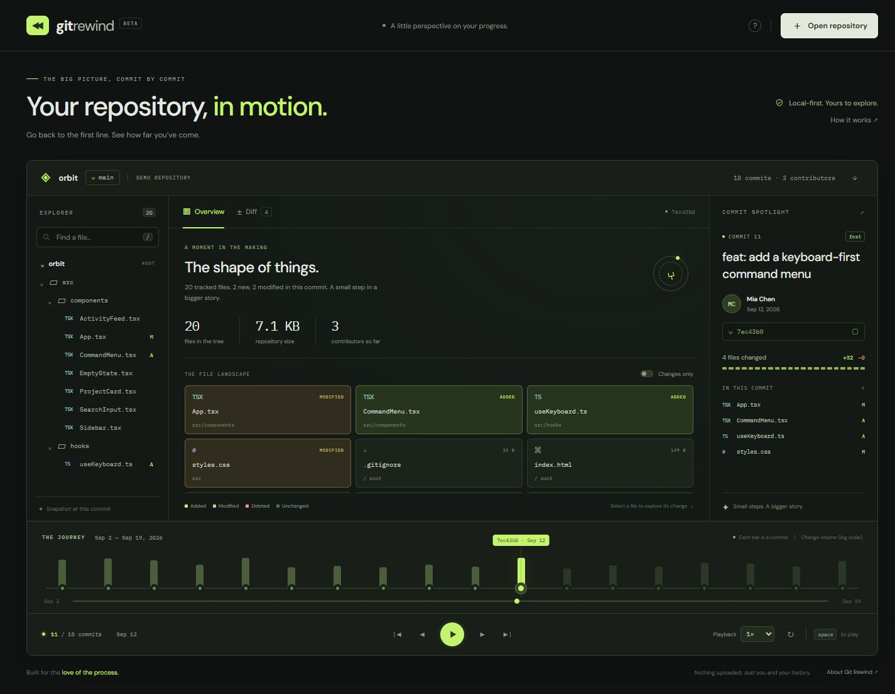
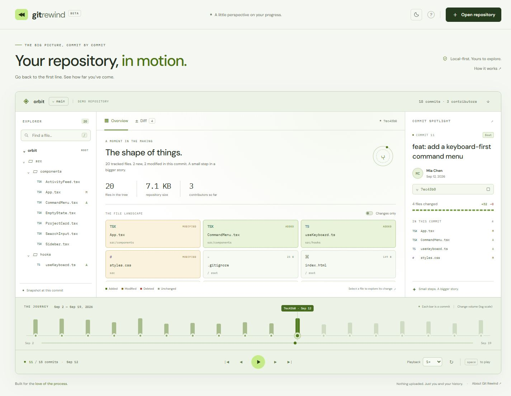

<p align="center"></p>
<h1 align="center">Git Rewind</h1>
<p align="center"><strong>Your repository, in motion.</strong><br>Go back to the first line. See how far you’ve come.</p>
<p align="center">Local-first · No runtime dependencies · Static hosting · MIT</p>



<details>
<summary>Prefer a little daylight? See the light theme.</summary>



</details>

Git Rewind turns committed Git history into a playable timeline. Watch the file tree evolve, jump between snapshots, and explore the patches that made a project what it is. Start with the included 18-commit demo, or bring your own repository.

## Start in 10 seconds

Requires **Node.js 20+**. No `npm install` needed.

```sh
npm run dev
```

Open **http://127.0.0.1:4173**. Press play and explore.

## Bring your own repository

Requires **Git** on your PATH. Run from the Git Rewind folder:

```sh
node bin/git-rewind.mjs /path/to/your/repository --out history.json
```

On Windows, quote paths containing spaces:

```powershell
node bin/git-rewind.mjs "C:\Projects\My App" --out history.json
```

In the player, choose **Open repository → Import history.json**. The browser reads the JSON locally; there is no upload endpoint. Only committed history on `HEAD` is read. The exporter does not modify your repository.

```sh
# Export the most recent 50 commits and set a friendly display name
node bin/git-rewind.mjs ../my-app --limit 50 --name my-app --out history.json
```

| Option | Default | Purpose |
| --- | --- | --- |
| `--out` | `history.json` | Output file path |
| `--limit` | `120` | Recent first-parent commits, from 1 to 500 |
| `--name` | Repository directory name | Label in the player |

**Before sharing an export:** it contains author names, commit messages, file paths, and source patches. Keep private histories private. `history.json` is ignored by Git by default.

## What you can do

- **Replay the journey.** Play, pause, skip, scrub, change speed from 0.5× to 4×, and loop.
- **Explore each snapshot.** Expand folders, search paths, and inspect tracked file counts, byte sizes and contributors.
- **See what changed.** Filter the landscape to changed files and inspect additions, modifications, renames and deletions.
- **Read the patch.** Syntax-free, line-oriented unified diffs with added/removed lines and copy controls.
- **Take history with you.** Import and download a versioned JSON export.
- **Make yourself comfortable.** Switch between light and dark themes with the sun/moon button. The first visit follows your system appearance; your choice is remembered locally, with the right theme applied before the first paint.
- **Use your keyboard.** `Space` to play/pause, `←` / `→` to step, `Home` / `End` to jump, `/` to search, `?` for help. Standard controls retain their native keyboard behavior when focused.

The interface adapts to mobile, tablet and desktop, respects reduced motion, and includes accessible labels and native dialogs.

## Host the demo

```sh
npm run build
```

Upload **`dist/`** to any static host. All asset paths are relative, including support for repository subpaths on GitHub Pages.

### GitHub Pages

1. Push this project to a repository with a `main` branch.
2. Open **Settings → Pages → Build and deployment → Source → GitHub Actions**.
3. Run **Deploy demo to GitHub Pages** from the Actions tab, or push to `main`.

The included workflow tests, builds and deploys the static player. It ships only the fictional demo history; your imported data stays in your browser. The `.openai/hosting.json` file is optional metadata for the Sites preview and is not needed for GitHub Pages.

## How it works

```text
Git working tree
  └─ CLI: git log → git ls-tree → git diff
       └─ history.json
            └─ Browser: timeline + snapshots + patches
```

The CLI invokes Git directly with argument arrays, without a shell. Each commit carries a complete tracked-file snapshot and the diff against its first parent. The browser validates the schema and renders imported text as text, never executable markup. No API keys, service accounts, database, or frontend framework are required.

```text
bin/git-rewind.mjs    Git → JSON exporter
index.html           Accessible application shell
app.js               Playback and interface behavior
model.js             Schema validation and tree utilities
style.css            Responsive interface
data/demo.json       Fictional project, real exported Git commits
scripts/             Static server, build, demo generator
tests/               Real-repository integration tests
```

## Scope and limits

- History follows **HEAD’s first-parent chain**. Merge snapshots include merged files, but side-branch commits are not replayed separately.
- The limit selects the most recent commits and plays them oldest to newest. An export may start after the repository’s original first commit.
- At most **10,000 tracked entries per snapshot**, **60 patches per commit**, and **45,000 characters per patch**. Omitted or truncated patches are labeled. The browser accepts JSON files up to **40 MB**.
- Binary changes show Git’s binary-change marker, not a binary preview. Submodules appear as tracked entries; their internal histories are not exported.
- This version shows per-commit patches, not full historical file contents. Unchanged files explicitly show that they have no patch in the selected commit.
- Timeline bar heights use a logarithmic scale so large commits do not drown out small ones. “Repository size” is the sum of tracked file bytes, excluding `.git`.
- Google Fonts is an optional presentation request. System fonts work when offline. Repository data is not included in that request.

## Development

```sh
npm test       # Integration tests create disposable Git repositories
npm run build  # Copy the player into dist/
npm run demo   # Rebuild the fictional sample from real Git commits
```

Tests cover initial commits, Unicode paths, modifications, renames, deletions, binary patches, first-parent merges, export limits and schema validation. CI runs on Windows and Linux. The fictional Orbit project is a history fixture, not a separate supported application.

## License

[MIT](LICENSE). Build something worth rewinding.
